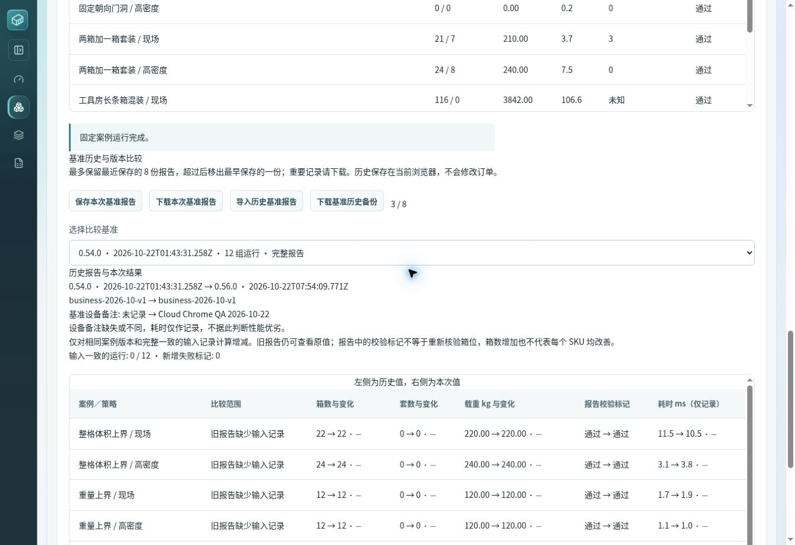
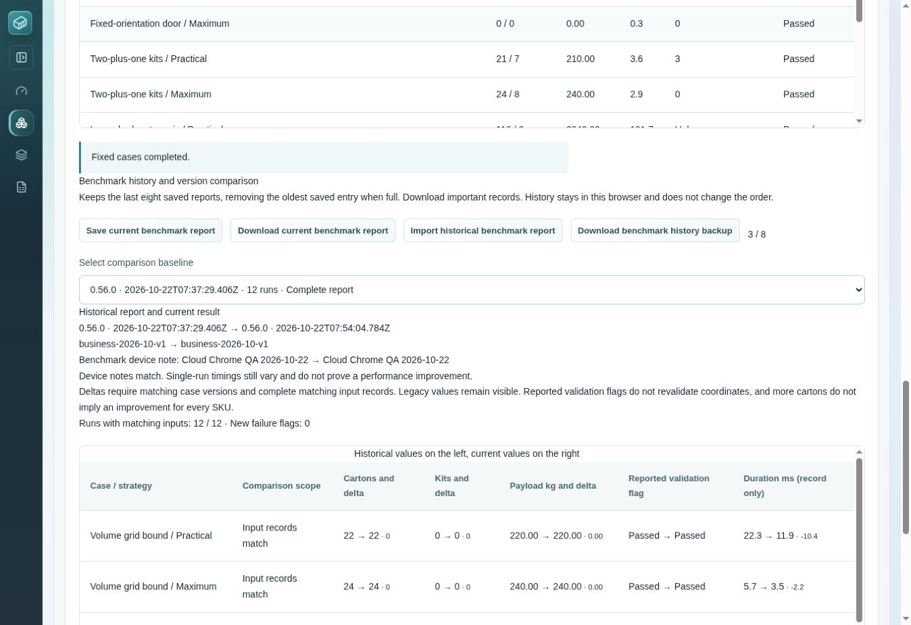

# v0.56.0 基准历史与版本比较

日期：2026-10-22。发布状态：完整软件回归、GitHub CI 和双站实际验收通过。

## 本轮变化

固定业务基准增加独立历史、原生报告／历史下载和导入、刷新恢复及逐案例比较。新报告带完整输入和参考依据；输入范围相同才计算箱数、套数、重量变化和新增失败标记。旧报告可查看原值，缺少输入记录时不自动推断算法进退；单次耗时和未记录设备条件不被称作性能提升。

本机最多保留 8 份，采用前完整验证文件；损坏历史保护原始内容，存储失败保留本页报告并提示下载。同步修复已记录的四种多柜终止原因英文显示，以及基准和历史状态在语言切换后仍保留旧语言的问题。

详见 [017B 阶段契约](field-upgrades/017b-benchmark-history.md)及[剩余清单](field-upgrades/unfinished-roadmap.md)。U23 继续 PARTIAL，隐藏验收集、复杂联合搜索、真实 GPU 和账号付费等未完范围保留。

## 验证与发布

`npm run build:pages` 完整通过：1,516 项单元测试（114 文件）、21 项页面结构检查、TypeScript 和静态生产构建；lint 0 错误、2 项既有警告。本轮新增 32 项核心与界面回归。

- 最终运行代码：`3fc8c3e92b0b88efb8bef6168f78175047de9d59`，树 `968be9d0cb43eb0196ad5442afc36da5c2d85907`。[GitHub CI](https://github.com/guodongbuding66-spec/container-load-planner/actions/runs/39742964856/job/119704458113) 通过。
- Vercel `dpl_BZr8wZ3aoro4jcSA3Uh4nHH824zb` 为 READY；Cloudflare `d15e80e9-2cac-4634-82e5-606629b6122e` 为成功。分别实际访问 [Vercel](https://container-load-planner-gray.vercel.app/) 和 [Cloudflare](https://container-load-planner.pages.dev/) 正式域名运行。
- 双站最终代码分别运行六案例两策略，共各 12 组，全部通过模型校验；原生报告均含完整输入。箱数、套数、重量、参考差距和采用来源一致，耗时和运行时间分别保留。固定夹具及版本号 `business-2026-10-v1` 未更改。
- 相同输入的历史比较为 12/12，新增失败标记 0。真实 v0.54.0 报告兼容导入，明确显示缺少输入记录；旧整托高密度 31 箱与本次 32 箱原值可见，但不计算改善增量。
- 三份真实历史报告经刷新、旧标签页保存前合并及跨站导入，再原生下载，内容逐字节一致。旧标签初始没有历史，保存时合并已有两份为三份；重复保存不新增。同时间标识内容冲突、重复案例和损坏 JSON 均被拒绝，拒绝前后历史备份逐字节一致。
- 中英文比较、完成状态和切回中文实际验证。多柜英文实际显示“Container limit reached”；该案例 32 箱、340 kg，未报价费用仍保持未知，详见[原生多柜报告](field-upgrades/evidence/v0.56.0-fleet.json)。最终双站重新运行后，英文历史区域无遗留中文。
- 双站恢复默认 3 SKU、40HQ、中文、现场策略，无临时 QA 柜型；双算法均为 116 箱、3,842 kg，并通过独立校验。[Vercel 原生工作区备份](field-upgrades/evidence/v0.56.0-workspace-vercel.json)额外核对输入及两份坐标；Cloudflare 本次备份下载已触发，但文件未同步到验收目录，故仅记录页面计算结果，不声明该备份文件通过。
- 最终双站控制台应用 error/warn 均为 0；Vercel 最终部署查询最近 30 分钟 error/fatal 无日志。静态前端日志为空不能替代功能验收。

## 原生证据

最终运行报告：[Vercel](field-upgrades/evidence/v0.56.0-report-final-vercel.json)、[Cloudflare](field-upgrades/evidence/v0.56.0-report-final-cloudflare.json)。历史备份：[合并结果](field-upgrades/evidence/v0.56.0-history-merged.json)、[刷新后](field-upgrades/evidence/v0.56.0-history-refreshed.json)、[最终 Vercel](field-upgrades/evidence/v0.56.0-history-final-vercel.json)、[最终 Cloudflare](field-upgrades/evidence/v0.56.0-history-final-cloudflare.json)。拒绝文件前后：[之前](field-upgrades/evidence/v0.56.0-history-before-reject.json)、[之后](field-upgrades/evidence/v0.56.0-history-after-reject.json)。[机器验收记录与文件摘要](field-upgrades/evidence/v0.56.0-acceptance.json)。

## 本轮限制与后续

8 份容量、边界字节数、损坏缓存保护和存储额度／拒绝访问通过软件测试；本次没有在正式浏览器注入额度／权限故障，也没有连续保存九次做浏览器淘汰测试。保存前重读减少旧标签覆盖，仍不是跨标签原子事务。报告校验标记不是箱位重新核验，单次耗时不是性能结论。

当前浏览器没有可用 WebGL，真实 GPU、多个浏览器、实机扫码、材料强度和现场试装继续 PENDING。U23 的隐藏验收集、重复性能统计及真实业务样本仍未完成；跨柜实物身份、复杂承托和联合重排等继续按剩余清单推进。具体叉车操作 EXCLUDED；账号、会员与支付仅保留后续接入计划，未启用。
