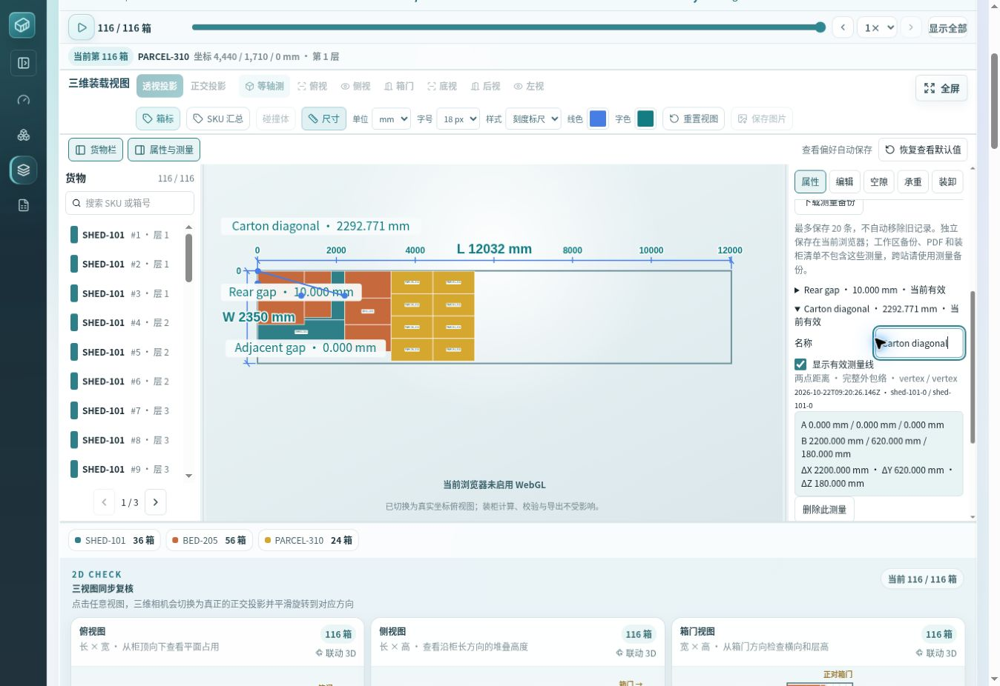

# v0.57.0 多条测量保存与失效管理

日期：2026-10-22。发布状态：完整软件回归、GitHub CI 及双站实际功能验收通过。

主三维的两点、两箱、柜壁测量现可保存多条，命名、显示或隐藏、删除并撤销，刷新后恢复，也可下载独立备份跨站导入。记录保留箱号、原始坐标和取点范围；方案改变后保留旧值、明确要求重测并停止画线，避免旧测量继续被当作当前净距。

沿用外包络测量；剖切外包络另作标记。三维和无 WebGL 的俯视图都接入多条叠加与尺寸开关。详情见 [015B 契约](field-upgrades/015b-saved-measurements.md)；实体曲面／凹槽与自动追随仍未完成，U18 继续 PARTIAL。

## 验证与发布

`npm run build:pages` 最终代码完整通过：1,552 项单元测试（117 文件）、21 项页面结构检查、TypeScript 和静态生产构建；lint 0 错误、2 项既有警告。本轮新增 36 项测试，并扩展既有三维叠加测试；真实挂载验证保存后的尺寸开关和方案改变后的移除。方案变化标记按方案缓存，不随码垛播放重复计算。

- 运行代码 `0e03b34e0f3438a89d48a533515667929c48a1af`，树 `4b57e815319641746f3ebcd0d4937975b74fd0fc`。[GitHub CI](https://github.com/guodongbuding66-spec/container-load-planner/actions/runs/39753921268/job/119741026449) 成功。
- [Cloudflare 正式站](https://container-load-planner.pages.dev/) 部署 `9f452103-068e-47fd-8c96-f1e80563f3f6` 成功；[Vercel 正式站](https://container-load-planner-gray.vercel.app/) 部署 `dpl_2Kdf7zpNbbgMoZwLPecBtamGmfhk` READY，正式别名确认。
- 两站实际恢复上一版原生工作区，通过当前规则校验箱位，显示算法 0.57.0；随后刷新并重新计算默认 3 SKU／40HQ，现场与高密度均为 116 箱、3,842 kg，中文与现场策略恢复。
- Cloudflare 实际取点保存三种记录：柜头净距 10 mm、箱体对角线 2,292.771 mm、相邻箱间距 0 mm。改名后恢复原名，显隐使俯视叠加 3→2→3，关闭尺寸使叠加降至 0，删除并撤销恢复至 3。
- 同编号不同名称的冲突文件和坏 JSON 均不采用。原生备份在拒绝前后、删除撤销后、刷新重算后、跨站导入后，以及最终双站下载后逐字节一致。两站刷新重算后均显示三条当前有效记录及三条叠加线。
- 双站切换高密度方案，三条历史数值保留并标“需重新测量”，旧叠加线为 0；切回原方案恢复有效。英文测量区域无遗留汉字，包含失效提示、保存状态、备份范围及三条记录；名称为测试时输入的英文名称。
- 两站最终各实际运行 12 组固定基准，全部结束、模型校验通过，原生 JSON 含完整输入记录。两站控制台应用 error/warn 为 0；Vercel 最终部署最近 30 分钟 error/fatal 查询无日志。静态日志为空不替代功能验收。

## 原生证据

[最初测量备份](field-upgrades/evidence/v0.57.0-measurements-cloudflare.json)、[删除撤销后](field-upgrades/evidence/v0.57.0-measurements-undo.json)、[拒绝坏文件后](field-upgrades/evidence/v0.57.0-measurements-after-reject.json)、[跨站导入后](field-upgrades/evidence/v0.57.0-measurements-migrated-vercel.json)、[Cloudflare 刷新后](field-upgrades/evidence/v0.57.0-measurements-refreshed-cloudflare.json)、[最终 Cloudflare](field-upgrades/evidence/v0.57.0-measurements-final-cloudflare.json)、[最终 Vercel](field-upgrades/evidence/v0.57.0-measurements-final-vercel.json)。

[上一版原生工作区](field-upgrades/evidence/v0.57.0-legacy-workspace.json)用于当前版本恢复测试。最终基准报告：[Cloudflare](field-upgrades/evidence/v0.57.0-benchmarks-cloudflare.json)、[Vercel](field-upgrades/evidence/v0.57.0-benchmarks-vercel.json)。[机器验收记录与文件摘要](field-upgrades/evidence/v0.57.0-acceptance.json)。

## 保留范围

测量使用独立备份，不包含在工作区备份、PDF 和装柜清单中。本次测量和基准原生下载已取得文件并核验；两份最终整工作区下载已触发，但文件未同步到验收目录，不声明这两份文件通过。默认结果已在实际页面核对，上一版工作区原生恢复已通过。

20 条上限、存储写入失败、损坏缓存、旧页冲突和读取取消通过软件测试；本次没有在正式浏览器注入存储故障或连续保存 20 条。变化标记用于检测方案变化，不是身份认证或数字签名。实体曲面／凹槽、自动追随特征和 PDF 测量页仍未实现，U18 继续 PARTIAL。

当前浏览器没有可用 WebGL；真实 GPU、多浏览器、现场试装及其他工程数据验收继续 PENDING。具体叉车操作 EXCLUDED；账号、会员及付费未启用。[未完成清单](field-upgrades/unfinished-roadmap.md)保留全部其他缺口。
