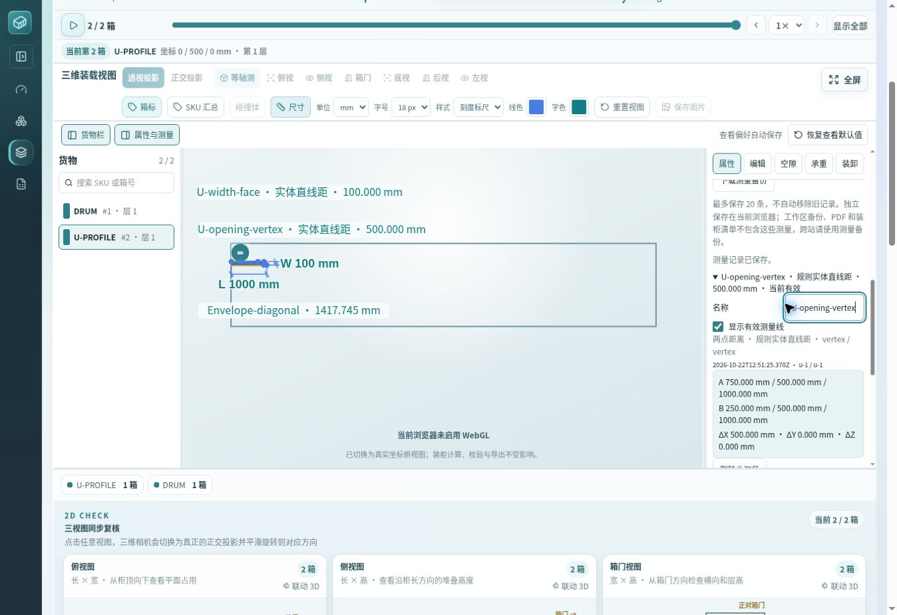

# v0.58.0 规则实体表面取点

日期：2026-10-22。发布状态：完整软件检查、GitHub CI、Cloudflare 和 Vercel 正式站功能验收通过。

两点测量新增“规则实体表面”，支持长方体、楔形、梯形、L／U／T 型和阶梯形。显示与捕捉共用截面、朝向及轴符号；精确取点显示 XYZ，保存实体参数，结果标记“实体直线距”。曲面、自定义／组合／导入模型及托盘结构暂不支持本轮实体取点；剖切开启时也不取人工切面。

范围和 v1／v2 文件契约见 [015C](field-upgrades/015c-regular-surface-measurements.md)。两点连线不是沿面长度或两件货物的全局最短净距。两箱间距、柜壁距离和尺寸标尺仍按外包络；碰撞、承托、装箱数量及重量算法未改变。

## 软件检查与发布

- `npm run build:pages` 通过：1,620 项单元测试（121 文件）、21 项页面结构检查、TypeScript 和静态生产构建。新增 68 项专项测试，包括 42 组外形与六种朝向的显示边界对照。后加极薄截面断言所在 57 项几何专项再次通过。最终 lint 0 错误、2 项既有警告。
- 恢复最新 GitHub 源码及历史迁移测试所需的 v0.50 原生文件，27 项迁移测试通过。首次完整尝试因本地缺少夹具而中止；补齐后完整检查通过，未修改旧迁移断言。
- 运行代码 `c26f393928de387396a29c33763344ecc59ebd65`，树 `c54c5dc1094c7ce30b2fd30add19af75df8b3363`，本地与 GitHub 一致。[GitHub CI](https://github.com/guodongbuding66-spec/container-load-planner/actions/runs/39781056573/job/119832106863) 成功。
- [Cloudflare 正式站](https://container-load-planner.pages.dev/) 部署 `94b91c3d-b5aa-4552-89bd-2b3f0c29fdc9` 成功；[Vercel 正式站](https://container-load-planner-gray.vercel.app/) 部署 `dpl_3bPZTJu7VsUJZyBorkX43WMkoxt3` READY，正式别名确认。下列操作均在正式域名完成。

## 实际操作验收

1. Cloudflare 原生恢复 U 型件和圆筒夹具，按当前规则重新校验箱位，显示算法 0.58.0。U 件为 1,000 × 100 × 1,000 mm，位于 0 / 500 / 0；顶点 A 750 / 500 / 1,000、B 250 / 500 / 1,000，实体直线距 **500 mm**。边捕捉为 750 / 550 / 1,000 到 250 / 550 / 1,000，同为 **500 mm**。
2. 凹形端面的面内参考点为 916.6666666666666 / 500 / 666.6666666666666 和 916.6666666666666 / 600 / 666.6666666666666，位于右壁实体内，距离 **100 mm**。外包络对角线独立显示 **1,417.745 mm**（三位小数）。切换依据清除未保存点，保存按钮禁用。
3. 保存两个实体记录和一个外包络记录，原生输出 v2。圆筒在实体依据下无取点按钮并显示暂不支持；开启剖切同样禁止新增实体取点。把实体文件改成 v1，或把端点改到槽内空处，均不采用；拒绝前后的原生备份逐字节一致。
4. 导入真实 v0.57 v1 备份：三条旧记录保持外包络身份、原始数值和需重测标记。六条记录跨站导入 Vercel 后逐字节一致，三条夹具测量在恢复的同方案中有效。Vercel 实际取点再次得到 500 mm。Cloudflare 切换高密度策略，历史值保留而叠加线从 3 降至 0；切回原方案恢复至 3。
5. 初始合成夹具未填写标准界面的三个搜索默认项；刷新后重新计算会补齐这些设置，签名改变，旧记录保守地要求重测。在标准界面的当前结果另存 `Current-U-opening` 后，两站刷新并按同设置重算，这条 500 mm 记录均当前有效、叠加线各为 1。刷新后的七条记录原生备份与刷新前逐字节一致。
6. Vercel 英文测量区域包含实体依据、直线距、当前／需重测和备份范围，未发现遗留汉字。两站各运行 12 组固定基准，全部运行结束、模型校验通过，取得含完整输入的原生报告。
7. 两站最终恢复默认 3 SKU／40HQ／中文／现场策略，两个策略均 116 箱、3,842 kg；清理本轮七条临时测量。应用域名过滤后的控制台 error/warn 查询为空；另有浏览器扩展元数据发送错误，未计作应用日志。Vercel 本次部署最近 30 分钟 error/fatal 查询无日志；静态站日志为空不替代功能验收。

## 原生证据

- [初始测量](field-upgrades/evidence/v0.58.0-measurements-solid.json)、[拒绝非法导入后](field-upgrades/evidence/v0.58.0-measurements-after-reject.json)。
- [合并真实 v1 后](field-upgrades/evidence/v0.58.0-measurements-merged-cloudflare.json)、[跨站 Vercel](field-upgrades/evidence/v0.58.0-measurements-vercel.json)。
- [当前设置下的七条记录](field-upgrades/evidence/v0.58.0-measurements-current.json)、[Cloudflare 刷新后](field-upgrades/evidence/v0.58.0-measurements-refreshed-cloudflare.json)、[Vercel 刷新后](field-upgrades/evidence/v0.58.0-measurements-refreshed-vercel.json)。
- [原始合成夹具](field-upgrades/evidence/v0.58.0-solid-fixture.json)为程序生成输入；[当前工作区](field-upgrades/evidence/v0.58.0-current-workspace.json)为页面原生下载，配合七条测量备份可重现有效的最后一条记录。
- 两站原生固定基准：[Cloudflare](field-upgrades/evidence/v0.58.0-benchmarks-cloudflare.json)、[Vercel](field-upgrades/evidence/v0.58.0-benchmarks-vercel.json)。[机器验收与文件摘要](field-upgrades/evidence/v0.58.0-acceptance.json)。

## 保留范围

U18 仍 PARTIAL：曲面和其他模型、全局实体两箱／柜壁净距、自动追随和 PDF 测量页未完成。测量独立备份，不包含在工作区、PDF 或装柜清单中；v2 回滚兼容见 015C。

小型取点夹具通过几何模型检查，但原有装卸路径复核存在失败与未分配卸货信息；它用于测量验收，不是现场可执行装柜方案。本轮未放宽路径、承重或运输固定校验；未重复声明 CSV／PDF 等未复测流程通过。

当前浏览器没有可用 WebGL，实际证据是坐标俯视图及 UI 操作；软件挂载与显示网格对照不替代真实 GPU。真实 GPU、多浏览器、额定工程资料及现场试装继续 PENDING。具体叉车操作 EXCLUDED；账号、会员和收费未启用。[未完成清单](field-upgrades/unfinished-roadmap.md)保留全部其他缺口。
