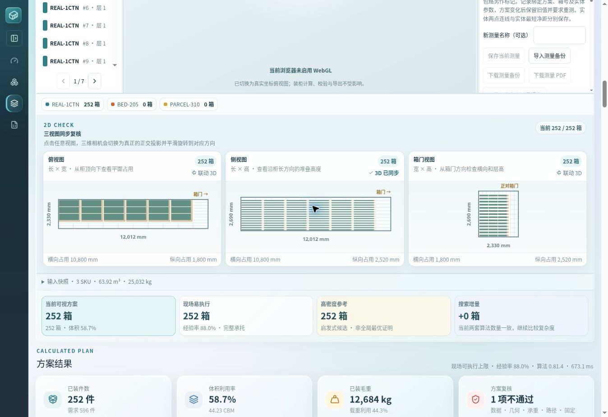
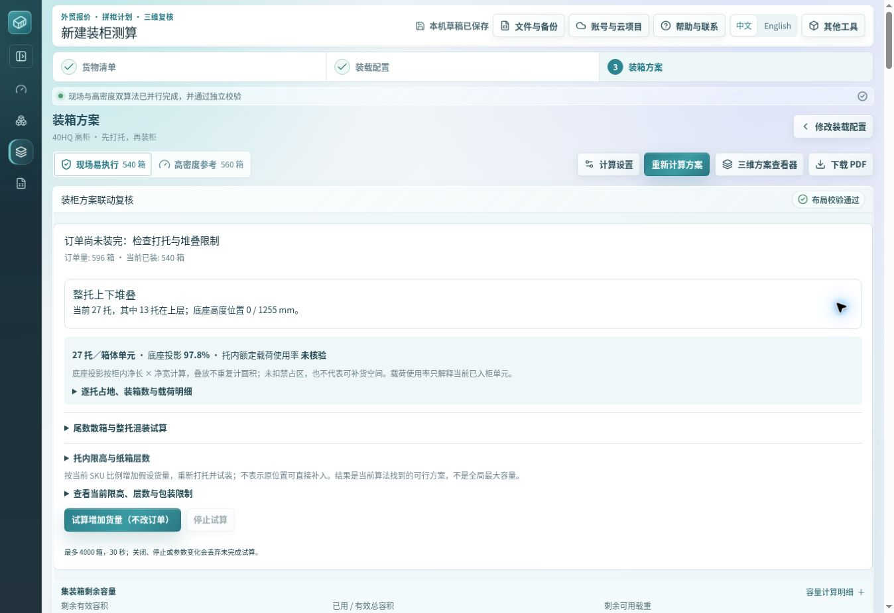

# v0.81.4 整托上下堆叠

2026-11-14（Asia/Shanghai）。

v0.81.3 修正的是托内纸箱分层，整托仍全部放在柜底，没有完成用户要求的整托上下堆叠。本次分开处理这两项设置。

- 可堆叠整托按实际外包络作为完整单元继续向上摆放，每层保留独立底座、自重、箱盖和货物坐标。柜高、门洞、边界、支承、订单数量和柜重仍参与计算。
- 新增整托堆叠开关、最多叠几层（0 按空间自动）、可选累计上压上限（0 明确禁止上压）。已填的额定上压和层数继续约束；明确禁止堆叠的结构不会被绕过。额定四角传力模式保留原有严格校验。
- 缺少额定资料的可堆叠声明用于空间预排，审计和导出标为结构承重待核对，不伪造已核验载荷。既有未启用的保存方案不自动改动，可在结果页直接启用并重算，尺寸保持不变。
- 每托箱数自动尺寸预览保留整托堆叠设置；允许采用前微调。提供明确的按订单准备托盘选项，将本规格与总生成上限设为 200，避免默认 50 托造成额外数量截断；可取消并保留库存限制。
- 工作区恢复、箱位校验、CSV、报告及编辑后复核使用相同堆叠规则；不允许用新输入恢复违反限制的旧坐标。

回归重建输入：596 箱，1640 × 545 × 120 mm，42 kg，40HQ。未取得用户原始工作区，不声称隐藏参数或现场结构已验证。

| 模式 | 整托外尺寸 mm | 每托箱数 | 现场易执行 | 高密度参考 |
| --- | --- | --- | --- | --- |
| 旧尺寸，未启用整托堆叠 | 1800 × 1800 × 180 | 3 | 18 箱 / 6 托 | 18 箱 / 6 托 |
| 同尺寸，启用整托堆叠，数量上限 200 | 1800 × 1800 × 180 | 3 | 252 箱 / 84 托 | 252 箱 / 84 托 |
| 按 3 箱自动尺寸并启用整托堆叠 | 1700 × 605 × 415 | 3 | 378 箱 / 126 托 | 378 箱 / 126 托 |
| 按 20 箱自动尺寸并启用整托堆叠 | 1700 × 1150 × 1255 | 20 | 540 箱 / 27 托 | 560 箱 / 28 托 |

同尺寸 3 箱算例包含 14 层完整托盘，最高底座 z=2340 mm。限制两层时为 36 箱；上压限制 151 kg 时也最多两层。保留 50 托数量上限时为 150 箱。不同每托箱数仍会受到实际底座/箱盖占用、外形、承重和离散排布影响，不承诺不同配方装箱数完全相同。

本地检查：168 个测试文件、2166 个测试及 21 个渲染检查通过；类型检查、API bundle 校验及静态生产构建通过。ESLint 保留两个已有警告。

## 线上原生验收

运行代码提交 `c5a20bf03f2d7f58cc281bbcd473a2d1d76dc8da` 已在主站和灰度站部署，[GitHub CI](https://github.com/guodongbuding66-spec/container-load-planner/actions/runs/43535667101) 成功。部署 ID、导出 SHA-256 和逐策略结果见 [验收清单](field-upgrades/evidence/v0.81.4-acceptance.json)。

通过线上页面原生控件操作并下载工作区备份，未注入页面计算状态：

1. 主站同尺寸恢复：旧版 18 箱 / 6 托；点击“允许整托叠放并重新计算”后为 252 箱 / 84 托，14 层整托，其中 78 托离地。每托仍为 3 箱，原 1800 × 1800 × 180 mm 外尺寸不变。
2. 主站自动 3 箱配方：重新建议尺寸，预览 1700 × 605 × 415 mm，采用后得到 378 箱 / 126 托，6 层整托，其中 105 托离地。
3. 主站自动 20 箱配方：输入箱数即生成 1700 × 1150 × 1255 mm 预览，采用后现场方案为 540 箱 / 27 托，参考方案为 560 箱 / 28 托，均含 2 层整托。
4. 灰度站手动微调：预览长度临时调为 1770 mm 时已保存尺寸保持 1750 mm；最终采用 1750 × 1150 × 1255 mm、20 箱方案，得到 520 箱 / 26 托，其中 13 托离地。备份确认本规格和总生成上限均为 200，整托堆叠启用。

五份原生导出均可通过坐标恢复与复核。检查货物数量、每托箱数、独立底座坐标、柜高、箱盖间隙、重量及整托层数。新增方案订单和柜型与旧版基线一致，恢复按钮没有暗改原包装尺寸。

运行存档验证：

```sh
node --experimental-transform-types --disable-warning=ExperimentalWarning docs/field-upgrades/evidence/v0.81.4-verify.mjs
```

本次浏览器未启用 WebGL，截图为产品自身的真实坐标二维投影；没有声称完成 GPU 三维渲染验收。整托可堆叠声明与额定结构承重仍分别展示；这些重建算例不构成实物承重认证。






